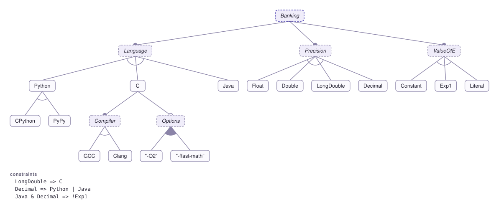

<!-- .slide: class="titre" -->

# Modelling variability: feature models and UVL

<div class="meta">
<p><strong>REP</strong> · Reproducibility of computational experiments · Lab #3</p>
<p>INSA Rennes · 2026-2027</p>
<p><strong>Mathieu Acher</strong> · mathieu.acher@irisa.fr · <a href="https://blog.mathieuacher.com/">blog.mathieuacher.com</a></p>
<p class="credit">Notation adapted from the <em>Software Product Lines</em> course of TU Braunschweig (T. Thüm, T. Kehrer, E. Kuiter et al., CC-BY-SA-4.0), via the CPOO 2026-2027 material; these slides are released under the same license.</p>
</div>
<div class="logos">


</div>

Note: Ten slides on the syntax and semantics of UVL. Running example: the banking problem of lab #1 (language, interpreter or compiler, options, precision, value of e). Given at the start of Part 4 of lab #3.

---

## The lab #3 pipeline

```text
fm/experiment.uvl        UVL Studio: write, count, configure
  │ sample.py            script (flamapy): produces data
  ▼
configs/sample.csv       one row = one configuration
  │ your script          template + compilation + CLI
  │ CI matrix            version, architecture
  ▼
results/results.csv      one row = one run
  │ analysis.ipynb       reads, produces nothing
  ▼
the factors that matter, and why
```

These slides: the first step, the `.uvl` file, and how to draw a sample from it.

---

## A feature model describes a space of configurations

- a **feature**: a characteristic that a variant has, or does not have
- a **configuration**: the set of selected features, i.e. **one** variant
- a **feature model**: a **tree** of features + **constraints**, describing all the
  **valid** configurations, and only them

Running example, the banking problem (lab #1):

> You deposit e ≈ 2.71828… €. Each year n, the banker takes a 1 € fee, then
> multiplies by n. Withdrawing costs 1 €. How much do you get after 50 years?

A program that answers is **one** configuration: a language, an interpreter or a
compiler, options, a precision, a way to get e…

---

<!-- .slide: class="figure-pleine" -->
## The diagram



<small>● mandatory · ○ optional · empty arc: **alternative** (exactly one) · filled arc: **or** (at least one) · dashed box: **abstract**</small>

Note: Drawn with the engine of UVL Studio. The tool shows the constraints in the editor; here they are listed under the tree. The model is uvl/banking.uvl: paste it into UVL Studio as is.

---

## Each construct has a meaning

| Construct | UVL | If the parent is selected… | Banking |
|---|---|---|---|
| **Mandatory** ● | `mandatory` | the child is too | `Precision`; `Compiler` under `C` |
| **Optional** ○ | `optional` | the child may be | `Options` |
| **Alternative** | `alternative` | **exactly one** child | `Language`: one language |
| **Or** | `or` | **at least one** child | `Options`: one option, or both |
| **Cardinality** | `[n..m]` | between n and m children | `[1..1]` = alternative, `[1..*]` = or |

And always:

- a selected child ⇒ its parent is selected; the root is always selected
- `{abstract}`: a feature that only **structures** the tree (`Language`, `Compiler`…),
  drawn dashed

---

## UVL: the text is the diagram

<div class="cols">
<div class="col" style="flex: 3 1 0">

```text
features
	Banking {abstract}
		mandatory
			Language {abstract}
				alternative
					Python
						alternative
							CPython
							PyPy
					C
						mandatory
							Compiler {abstract}
								alternative
									GCC
									Clang
						optional
							Options {abstract}
								or
									"-O2"
									"-ffast-math"
					Java
			Precision {abstract}
				...
```

</div>
<div class="col" style="flex: 2 1 0">

- two sections: `features`, then `constraints`
- **indentation** makes the tree (tabs or spaces: always the same)
- a **group** keyword between a parent and its children, never a child directly
  under a feature
- names with spaces or special characters: in **double quotes**, `"-O2"`
- `Language {abstract}`
- comments: `//` and `/* … */`

</div>
</div>

Note: UVL = Universal Variability Language, the standard text format of the software product line community. The full file is uvl/banking.uvl.

---

## Cross-tree constraints

They relate features from **different branches** of the tree.

| UVL | Meaning | Example |
|---|---|---|
| `A => B` | A **requires** B | `LongDouble => C` |
| `A => !B` | A **excludes** B | `Decimal => !C` |
| `A \| B` | or | `Decimal => Python \| Java` |
| `A & B` | and | `Java & Decimal => !Exp1` |
| `!A` | not | `!(Java & Decimal & Exp1)` |
| `A <=> B` | equivalence | `(A => B) & (B => A)` |

Precedence, loosest to tightest: `<=>`, `=>`, `|`, `&`, `!`.
`Java & Decimal => !Exp1` reads `(Java & Decimal) => (!Exp1)`.

> A constraint always has a reason: write it as a comment,
> `Java & Decimal => !Exp1 // BigDecimal has no exp()`.

Note: Here, Decimal => !C and Decimal => Python | Java say the same thing: the alternative under Language allows one language only. Likewise, !(Java & Decimal & Exp1) is the third constraint of the model, written differently.

---

## Semantics: a Boolean formula

One variable per feature; the model is the **conjunction** of:

| Construct | Formula |
|---|---|
| child `B` of `A` (always) | `B ⇒ A` |
| `B` **mandatory** under `A` | `A ⇒ B` |
| **or** group `B₁…Bₙ` under `A` | `A ⇒ (B₁ ∨ … ∨ Bₙ)` |
| **alternative** group | the same, + `¬(Bᵢ ∧ Bⱼ)` for all `i < j` |
| constraint | as is |

**Valid configuration** = an assignment that makes the formula true:

| Selection (+ the 4 abstract features at the top) | |
|---|---|
| `C`, `GCC`, `LongDouble`, `Exp1` | ✅ |
| `Python`, `CPython`, `PyPy`, `Double`, `Constant` | ❌ one interpreter only |
| `Python`, `CPython`, `LongDouble`, `Constant` | ❌ `LongDouble => C` |
| `C`, `GCC`, `Options`, `Float`, `Exp1` | ❌ or: at least one option |

Note: The 4 abstract features at the top: Banking, Language, Precision, ValueOfE. In the C rows, Compiler is selected too (mandatory under C).

---

## Counting and analysing

An alternative **adds up** the configurations of its children; independent branches
**multiply**:

| Feature | Computation | Configurations |
|---|---|---|
| `C` | `Compiler` (2) × `Options` (1 + (2² − 1) = 4) | 8 |
| `Language` | `Python` + `C` + `Java` = 2 + 8 + 1 | 11 |
| `Banking` | `Language` × `Precision` × `ValueOfE` = 11 × 4 × 3 | **132** |

The three constraints remove some of them: **98** valid configurations.

- **dead** feature: in no configuration. `"-ffast-math" => Java` (a bad copy-paste)
  kills it: 98 → 62
- **core** feature: in every configuration (`Banking`, `Language`, `Precision`, `ValueOfE`)
- **false-optional** feature: optional, yet present whenever its parent is
- **void** model: no valid configuration at all

Note: Checked on 2026-10-19 with the UVL Studio engine and flamapy 2.6.0: 132 without constraints, 98 with them, 62 with uvl/banking-dead.uvl (dead = [-ffast-math]); core = Banking, Language, Precision, ValueOfE. By hand: Python 2 × 3 precisions × 3 values of e = 18; C 8 × 3 × 3 = 72; Java (Float, Double) × 3 + Decimal × 2 = 8; total 98.

---

## The tools: UVL Studio, then `sample.py`

**https://blog.mathieuacher.com/uvl-studio/**: in the browser, nothing to install.

- editor with live diagnostics; **UVL cheat sheet** tab
- **configurator**: tick a feature, **propagation** does the rest
- **Analysis**: number of configurations, dead, core and false-optional features
- examples **Sandwich**, **Server**, **Pizza**; **Save .uvl**: the committed file is the reference

Then `sample.py` (flamapy, Python ≥ 3.11), on the same `.uvl` file:

```bash
python sample.py fm/experiment.uvl --size 30 --seed 1 -o configs/sample.csv
```

`--include mine.csvconf`: a configuration of your own, one line `Feature,True` per feature.

<small>UVL: universal-variability-language.github.io · flamapy: flamapy.github.io</small>
